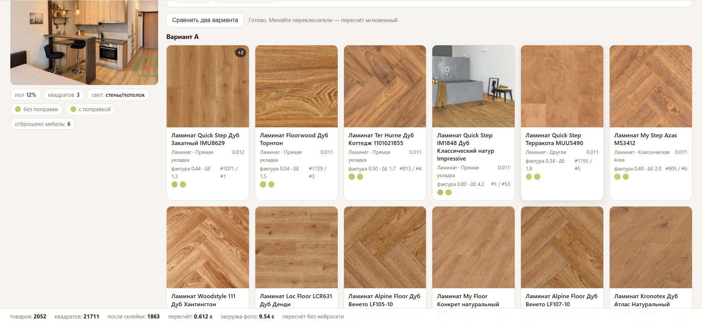
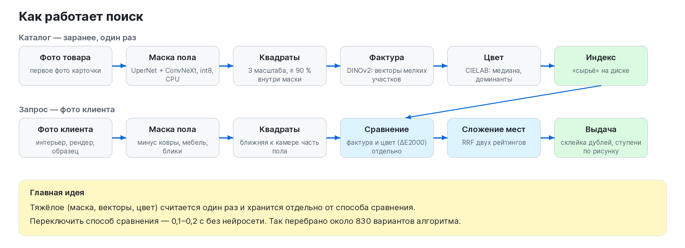
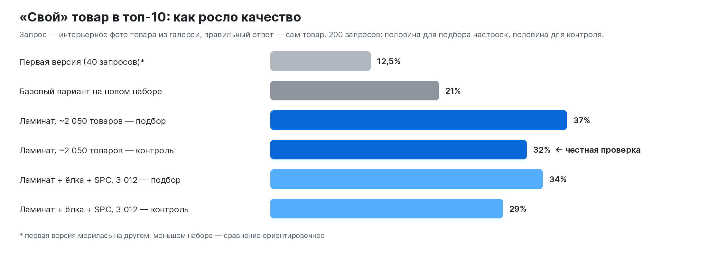
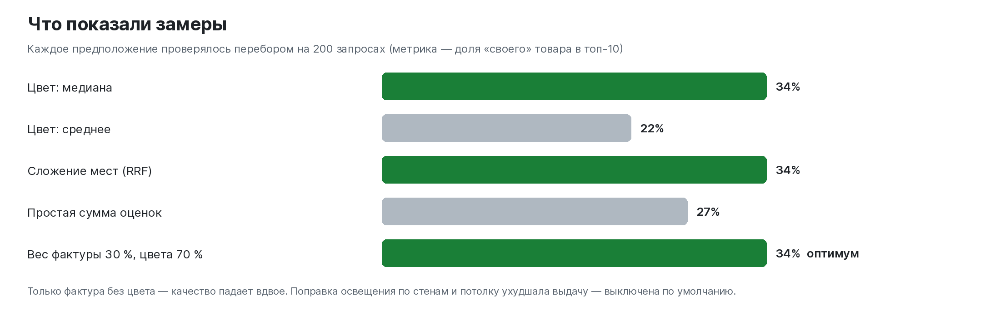

# Visual Search for Flooring by Photo

**[Русская версия](README.md)**

A customer sends a photo of a floor — a Pinterest interior, a designer's render, a phone snapshot of a sample. The service finds the floor in the photo, removes rugs, furniture and glare, describes the floor by colour and texture, and returns similar products from an online flooring store's catalogue. Open models only, on a regular CPU, no paid APIs; customer photos never leave the system.

> **This is a project description.** The code is not published. Status: working internal prototype.

## Why

Customers don't know collection names; they know what the floor looks like. Instead of a manager scrolling through hundreds of decors, the service gives a ranked list in seconds. Main scenarios: "like in this picture", a replacement when the chosen product is out of stock, and a real product for a designer's render. The same index powers "similar products" on product pages, a light-to-dark colour scale of the catalogue for purchasing, and checks of product-card errors.

Generic visual search compares whole images and finds a similar room or sofa, not the floor; flooring-specific services target Western retailers; describing the floor with a large model via API gives coarse ranking and inaccurate colour. Hence: a custom pipeline of off-the-shelf open models, no training from scratch.

## How it works

1. **Floor mask:** UperNet + ConvNeXt-Tiny (ADE20K), ONNX int8 on CPU; rugs are a separate class; close-up / interior / whole-frame modes; white backgrounds of samples are cut out.
2. **Multi-scale patches** on both catalogue and query side, only patches ≥ 90 % inside the mask.
3. **Texture:** DINOv2-small, patch-token mean beat the CLS vector.
4. **Colour:** CIELAB median and dominant colours, CIEDE2000. Lighting correction was implemented but hurt results and is off by default.
5. **Fusion:** Reciprocal Rank Fusion of the texture and colour rankings, duplicate decors merged, results tiered by pattern and material.
6. **Pattern and material:** zero-shot SigLIP 2 for laying pattern (0.960 accuracy, 0.979 balanced on interior photos), a logistic-regression head on SigLIP 2 embeddings for wood/stone (0.965); splits by product and collection.

## Evaluation

An interior photo from a product's gallery is the query, the product itself is the answer; the index holds only the first (close-up) photo. 200 queries split into tuning and control halves; about 830 configurations tested.

## Key finding: data matters more than the model

10 % of product cards in a 3,012-product index (21 % in the extended 5,166 set) contradict their photos — e.g. "French herringbone" in the card, a straight plank in the photo; 177 groups of products share one photo. A labelling tool shows card label vs model prediction and confidence so disputed cards are fixed before any training.

## Engineering

Measurements over intuition; heavy features computed once and kept separate from the matching method (0.1–0.2 s to switch); honest tuning/control split; frozen snapshots protect a good ranking from regressions; long stages (catalogue crawl at ≤ 2 req/s, labelling thousands of photos, embeddings) were run and supervised by a local agent with logs and resumable steps; segmentation (ONNX Runtime) and embeddings (PyTorch) run as two HTTP services; only MIT / Apache 2.0 models.

## Status and plans

Done: laminate (~2,050 products) working locally, index extended to 3,012 products, pattern and material detection, interface, colour scale, labelling tool. Next: full catalogue (~12k products), all product photos, training on verified labels, a manual evaluation set from consultants, deployment with "find by photo" and "similar in stock" on the website.

Related project: [AI-Floor](https://github.com/ShubaAlex/ai-floor-visualizer) — trying the chosen floor on a room photo.

## My role

The project grew out of a daily sales task. I defined the scenarios and what "similar floor" means for a buyer, researched existing solutions and models, designed the architecture and the honest evaluation method, ran the project stage by stage with result reviews, and made decisions based on measurements. I'm now extending the catalogue and preparing the website launch.
