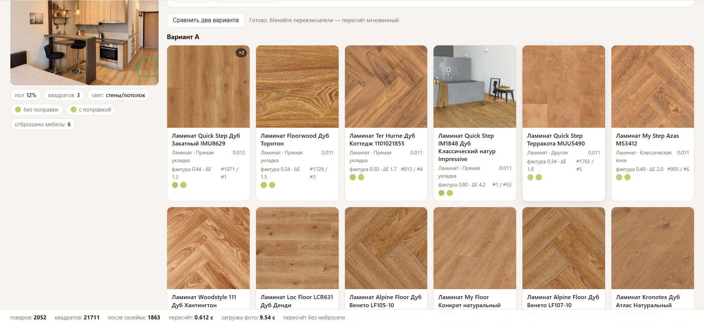
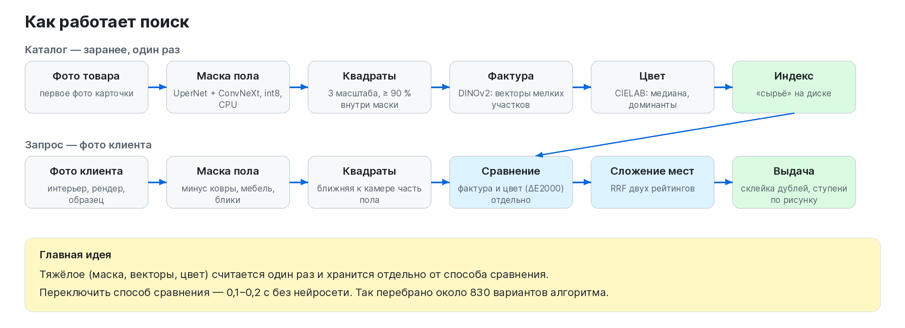
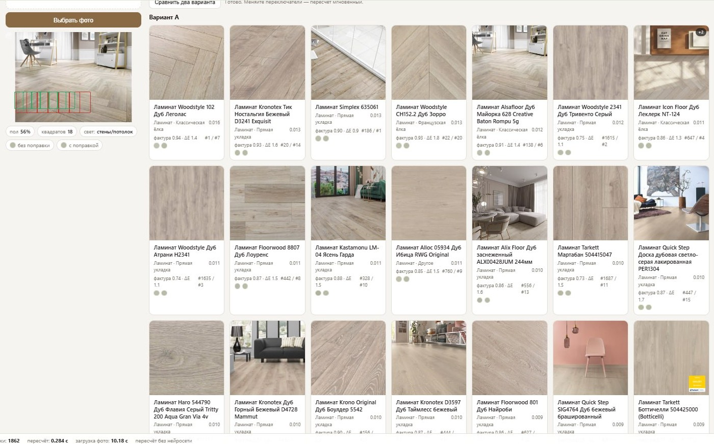
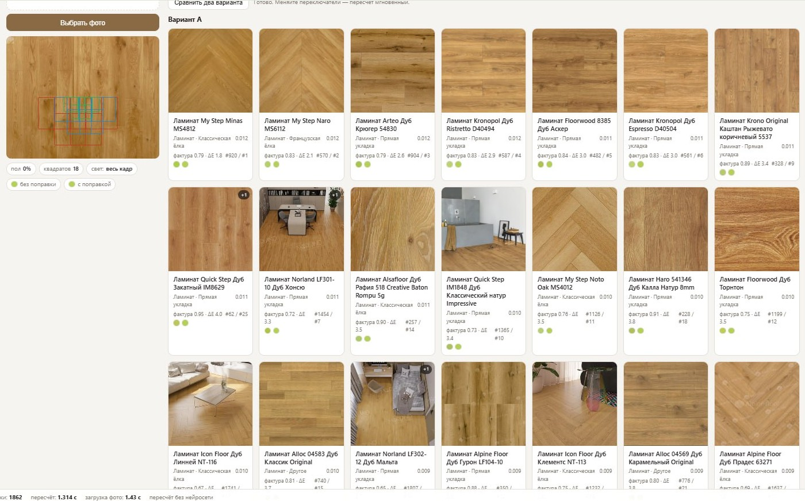
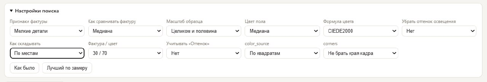
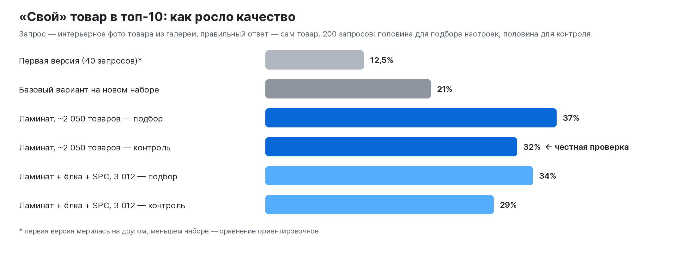
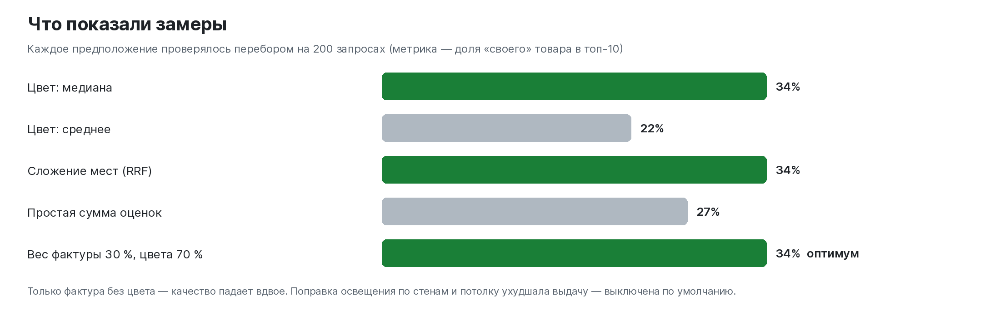
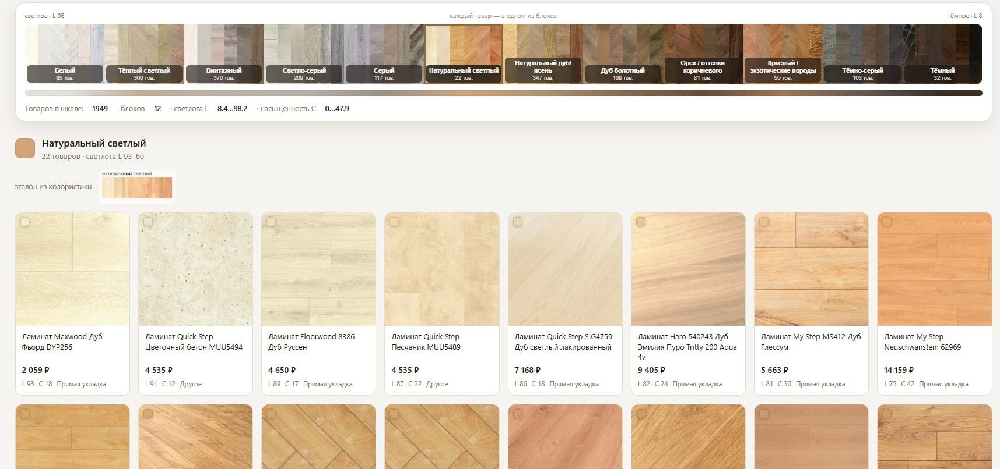

# Поиск напольного покрытия по фото

**[English version](README.en.md)**

  

Покупатель присылает фото пола: интерьер с Pinterest, рендер дизайнера, снимок у знакомых, образец доски на телефон. Сервис находит на фото пол, отсекает ковры, мебель и блики, описывает пол цветом и фактурой и показывает похожие товары из каталога интернет-магазина напольных покрытий. Кроме цвета и фактуры система определяет на фото рисунок укладки и материал и ставит выше товары с тем же рисунком; следующий шаг — селекция (натур, селект, рустик). Всё работает на открытых моделях, на обычном процессоре, без платных API; фото покупателей никуда не отправляются.

> **Это описание проекта.** Код не публикуется. Здесь задача, архитектура, этапы, замеры и планы. Сервис — работающий внутренний прототип.

## Зачем

Клиент не знает названий коллекций. Он знает, как пол выглядит, и приходит с картинкой: «хочу вот такой». Дальше менеджер вручную листает сотни декоров, и результат зависит от его опыта. Сервис заменяет этот перебор выдачей за несколько секунд.

**Главные сценарии**
1. **«Как на картинке».** Клиент прислал фото — менеджер загружает его и сразу видит похожие товары с ценой и наличием.
2. **Товара нет в наличии.** Выбранный декор закончился или снят с производства — нужна похожая альтернатива, иначе клиент уйдёт.
3. **Пол с визуализации дизайнера.** Рендер сделан на текстуре, которой может не быть в продаже. Нужен ближайший реальный товар.

**Что ещё даёт тот же индекс**
- аналог дешевле или дороже, в том числе «как паркет, но ламинатом»: поиск идёт по виду пола поверх брендов и категорий;
- подбор не зависит от опыта менеджера — новичок получает ту же первую выдачу;
- блок «похожие товары» в карточке и замена для позиций «нет в наличии»;
- цветовая шкала каталога (в работе): каких тонов в ассортименте мало, а какие дублируются — подсказка для закупок;
- проверка карточек: модель видит ёлку, а в карточке написано «прямая доска»;
- нет платы за каждый поиск и нет передачи фото клиентов третьим лицам.

**Почему не готовое решение.** Обычный поиск по картинке сравнивает изображение целиком и на фото интерьера находит похожую комнату или диван, а не пол. Специализированные сервисы для магазинов полов работают с западными ритейлерами. Описание пола словами через большую нейросеть по API даёт грубое ранжирование и неточный цвет. Выбран путь: своя цепочка из готовых открытых моделей, без обучения с нуля.

## Что для покупателя значит «похожий пол»

От главного к второстепенному: светлота, оттенок (тёплый / нейтральный / серый), рисунок укладки (доска, классическая или французская ёлка, модули), фактура и селекция (сучки, разнотон), ширина доски и фаска, блеск, порода, материал (дерево или камень).

Отсюда архитектура: нужны **и цвет по пикселям, и векторы фактуры, и атрибуты**. Цвет точно передаёт тон, но не видит сучков и рисунка. Векторы видят фактуру, но путают освещение с цветом.

## Как устроено

### 1. Находим пол
- Модель сегментации **UperNet + ConvNeXt-Tiny** (ADE20K), в ONNX с квантованием int8, на процессоре. В ADE20K «пол» и «ковёр» — разные классы, поэтому ковры отсекаются сразу.
- Маска сужается, чтобы отрезать плинтусы и края мебели; берётся крупнейшая связная область.
- По доле пола выбирается режим: **крупный план**, **интерьер** или **весь кадр** (пол не найден, но кадр однородный — это макрофото текстуры).
- Отдельно — **«доска на столе»**: у образцов на белом фоне фон вырезается по светлым малонасыщенным пикселям у края кадра. Без этого такие фото давали пустую маску и мусорную выдачу.

*Интерьер со светлой ёлкой: пол — 56 % кадра, квадраты берутся из ближней к камере части пола, выдача — светлые дубы того же тона.*

### 2. Режем на квадраты
На крупном плане в кадре 2–3 доски, на интерьере — 6–10, мелких и сжатых перспективой. Поэтому квадраты берутся **в нескольких масштабах с обеих сторон**: у товара — вся область, половины и четверти (около 11 на товар), у запроса — три масштаба из ближней к камере части пола. Квадрат берётся, только если он на 90 % внутри маски; блики и глубокие тени отбрасываются.

*Образец доски крупным планом: пол на весь кадр, 18 квадратов трёх масштабов (рамки слева), выдача по фактуре и цвету с оценками и местами в обоих рейтингах.*

### 3. Фактура
**DINOv2-small**: на каждый квадрат два вектора — общий и среднее по мелким участкам. Второй лучше передаёт мелкую фактуру и **выиграл в замере**.

### 4. Цвет
Цвет считается по пикселям пола в пространстве **CIELAB**, где разница в цифрах соответствует разнице на глаз. Медиана, среднее без крайних, доминирующие цвета (k-means); разница — **CIEDE2000**. Поправка освещения по стенам и потолку тоже реализована, но по замеру мешала: человек хочет тот пол, который видит на картинке, а не «физически настоящий».

### 5. Сложение и выдача
- Сходство фактуры у всех товаров лежит в узком диапазоне, а цвета — широком; при простой сумме выдачу определял один цвет. Поэтому два рейтинга складываются **по местам (Reciprocal Rank Fusion)**.
- Один декор в разных толщинах даёт одинаковые фото — в выдаче он показывается один раз. Снятые с продажи товары исключаются.
- **Ступени по атрибутам:** сначала товары с тем же рисунком и материалом, потом с одним совпадением, потом остальные.

### 6. Рисунок и материал — первая итерация
- **Рисунок укладки** определяется **без обучения**: SigLIP 2 сравнивает фото с текстовыми описаниями классов (прямая, классическая ёлка, французская ёлка, модульный паркет).
- **Материал** (под дерево / под камень) — небольшой классификатор (логистическая регрессия) поверх готовых векторов SigLIP 2; сама нейросеть не дообучается.
- Разбиение для проверки — **по товарам и коллекциям**, чтобы модель училась рисунку, а не узнавала конкретный декор.

Первая версия обучалась и проверялась **на малой выборке и на метках из карточек сайта**, без ручной разметки. Предварительные замеры:

| Задача | Точность | Сбалансированная точность |
|---|---|---|
| Рисунок укладки, 3 класса, без обучения | 0,960 | 0,979 |
| Материал, обученный классификатор | 0,965 | 0,979 |
| Рисунок + материал, 4 класса (на карточках) | 0,916 | 0,918 |
| Модульный паркет без обучения | 456 из 467 | — |

Главный вывод этой итерации — не цифры, а расхождения: модель нашла много товаров, у которых на сайте указан рисунок «ёлка», а на фото не ёлка (подробнее ниже). Учиться на таких метках нельзя, поэтому **сейчас идёт ручная разметка**; на проверенных данных классификатор будет переобучен, и ранжирование по рисунку станет точнее.

## Как измеряли качество

- **Проверочный набор строится сам.** В галерее товара обычно есть интерьерное фото: оно подаётся как запрос, правильный ответ — сам товар. В индексе при этом только первое фото (обычно крупный план) — сознательно трудная постановка.
- **200 запросов**, случайно разбитых пополам: на «подборе» выбираются настройки, на «контроле» они честно проверяются.
- Метрики: «свой» товар в топ-1 / 5 / 10 / 48, MRR, товар той же коллекции в топ-10.
- Перебрано **около 830 сочетаний** способов сравнения фактуры, цвета, поправки света, сложения и весов — поэтапно, без повторной обработки каталога.

### Подбор настроек

Каждый этап алгоритма вынесен в переключатель на странице поиска: признаки и способ сравнения фактуры, масштаб квадратов, статистика и формула цвета, поправка освещения, способ сложения, вес фактуры и цвета, учёт поля «Оттенок», края кадра. Кнопки «Как было» и «Лучший по замеру» и режим «два варианта рядом» позволяют сравнить выдачу глазами, а те же переключатели прогонялись автоматически по всем 200 запросам с подсчётом метрик.

Лучшая конфигурация по замеру:

| Настройка | Лучший вариант | Что проигрывало |
|---|---|---|
| Признаки фактуры | векторы мелких участков | общий вектор картинки |
| Сравнение фактуры | медиана по квадратам | «лучшая пара» квадратов — не лучше простой статистики |
| Масштаб образца | целиком и половина | — |
| Цвет пола | медиана | среднее (0,22 против 0,34 в топ-10) |
| Формула цвета | CIEDE2000 | взвешенная евклидова |
| Поправка освещения | выключена | поправка по стенам и потолку ухудшала выдачу |
| Сложение | по местам (RRF) | простая сумма (0,27 против 0,34) |
| Фактура / цвет | 30 / 70 | только фактура — качество вдвое ниже |
| Поле «Оттенок» из карточки | не учитывать | — |
| Цвет | по квадратам, без краёв кадра | по всей маске, с краями |

Разница между подбором и контролем — около 5 пунктов: признаков подгонки нет. Строгая метрика «ровно свой товар» занижает пользу — покупателю подходит и похожий декор, а по цвету выдача на глаз очень точная.

## Главная находка: данные важнее модели

У проекта два источника правды: **карточка товара** (что написано) и **фото** (что видно). Они расходятся:

- в индексе из 3 012 товаров — **301 расхождение (10 %)** между карточкой и тем, что модель видит на фото;
- в расширенном наборе из 5 166 товаров — **1 109 (21 %)**, в основном инженерная и паркетная доска;
- **177 групп** товаров (366 карточек) с одинаковым фото;
- товары, снятые с сайта, но отдаваемые фидом как доступные.

Типичный случай: в карточке «французская ёлка», а на фото прямая доска — когда товар заводили, нужного снимка у производителя не было. В результате клиент фильтрует «ёлку» и видит прямую доску. Чтобы не учить модель на ошибках карточек, сделан **инструмент ручной разметки**: видно, что говорит карточка, что говорит модель и насколько она уверена, спорное исправляется одним кликом.

## Инженерные решения

- **Замер вместо интуиции.** «Медиана лучше среднего», «поправка света поможет», «лучшая пара квадратов лучше среднего» — каждое предположение проверено перебором; часть оказалась неверной.
- **Сырьё отдельно от алгоритма.** Маска, векторы и цвет считаются один раз; способ сравнения переключается за 0,1–0,2 с.
- **Честная проверка:** подбор и контроль, склейка дублей, отдельная оговорка про несравнимые наборы.
- **Не сломать работающее.** Перед доработками выдача замораживается (снимок топ-200 по 20 фото) и после правок сверяется; версии живут отдельно, новые эксперименты не перезаписывают модели и индекс, пока не доказано, что стало лучше.
- **Долгие этапы под контролем.** Обход каталога, скачивание фото (не больше 2 запросов в секунду к сайту), разметку тысяч снимков и расчёт векторов вёл и контролировал локальный агент: журналы, пропуск готового, продолжение с места остановки, кеш по хешу файла.
- **Два процесса.** Сегментация на ONNX Runtime и векторы на PyTorch работают отдельными сервисами и общаются по HTTP.
- **Лицензии.** Используются только модели с коммерческими лицензиями (MIT, Apache 2.0); SegFormer, Depth Anything V2 Base/Large, DINOv3 и SAM 3 сознательно не взяты.

### В работе: цветовая шкала каталога

Попутная задача, которая появилась по ходу проекта. Весь каталог раскладывается в одну ленту от светлого к тёмному и делится на 12 цветовых блоков по эталонам колористики (белый, тёплый светлый, винтажный, светло-серый, серый, натуральный светлый, натуральный дуб / ясень, дуб болотный, орех, красные и экзотические породы, тёмно-серый, тёмный). Каждый товар попадает в ближайший по цвету блок, внутри блока — от светлого к тёмному. Клик по блоку показывает все его товары рядом с эталоном. Это нужно, когда клиент говорит «хочу чуть темнее вот этого», и для закупок: видно, каких тонов мало, а какие дублируются.

## Статус и планы

**Сделано:** локальный сервис на ламинате (~2 050 товаров), расширение индекса до 3 012 товаров (ламинат, паркет-ёлка, SPC), первая версия определения рисунка и материала на метках сайта, интерфейс с переключателями и сравнением двух вариантов, инструмент разметки карточек.

**В работе и планах:**
1. Цветовая шкала каталога по 12 блокам колористики (см. выше).
2. Полный каталог — около 12 тыс. товаров в 9 разделах; сейчас обрабатывается 5 166.
3. Все фото товара, а не только первое.
4. Ручная разметка рисунка и материала (идёт сейчас) и переобучение классификатора на проверенных данных; лёгкий слой поверх DINOv2 на парах «интерьер ↔ крупный план того же товара».
5. Ручной проверочный набор от консультантов и метрики «подходящий в топ-5», nDCG@10.
6. Определение селекции по фото (натур / селект / рустик) и подбор с её учётом.
7. Бизнес-ранжирование поверх похожести: при близком сходстве выше показывать товары в наличии, более маржинальные, популярные, часто покупаемые или с лучшими отзывами — и проверять варианты A/B-тестами.
8. Выкладка на сервер, кнопка «Подобрать пол по фото» и «Похожие в наличии» в карточке товара, бот для клиентов.

Соседний проект — [AI-Floor](https://github.com/ShubaAlex/ai-floor-visualizer): примерка выбранного пола на фото комнаты.

## Стек

Python, PyTorch, Hugging Face Transformers, ONNX Runtime (int8, CPU), scikit-learn, NumPy, Pillow, FastAPI, HTML/JS без фреймворков.

| Модель | Назначение | Лицензия |
|---|---|---|
| UperNet + ConvNeXt-Tiny (ADE20K) | маска пола | MIT |
| DINOv2-small | векторы фактуры | Apache 2.0 |
| SigLIP 2 base | рисунок без обучения, материал | Apache 2.0 |

## Моя роль

Проект вырос из ежедневной задачи продаж: подобрать пол «как на картинке» и быстро найти замену товару, которого нет. Я сформулировал сценарии и критерии «похожего пола», исследовал готовые решения и модели, спроектировал архитектуру и методику честных замеров, вёл проект по этапам с проверкой выдачи на каждом шаге и принимал решения по результатам замеров. Сейчас расширяю каталог и готовлю запуск на сайте.
